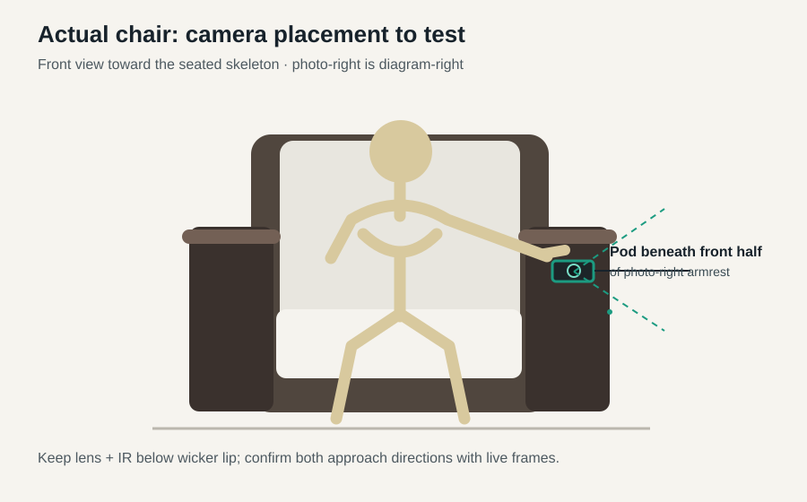

# Concealed chair camera pod — first-fit prototype

The Freddy mask will sit in a skeleton's lap on the single wicker chair shown in [Joshua's actual-chair photo](../../reference_images/wicker_chair_skeleton.png). The chair faces open concrete. A first position to **test** is beneath the **front half of the armrest on the right side of the photo**, with the lens and IR openings just below the woven front/outer lip. This keeps the camera above the seat underside and away from the cushion. The skeleton's hand rests farther back on that armrest, so the pod must stay clear of its fingers and any hanging decorations. This is a candidate position, not a verified installation; camera frames must confirm both approaches are visible. The camera can supply target coordinates to Freddy's eyes after calibration.

## Files and size

- `chair_camera_pod.scad` is the editable master. Set `part` to `tray` or `cover` to export each part in a CAD tool.
- `chair_camera_tray_draft.stl` and `chair_camera_cover_draft.stl` are printable first-fit exports. They use a 0.4 mm grid because OpenSCAD is unavailable on this machine; re-export from the CAD master for smooth final holes.
- `export_draft_stl.py` regenerates those prototype STLs.

The tray is approximately **78 × 54 × 13 mm** including its rear strap ears. The removable front cover is 54 × 54 × 2.4 mm. Two 5 mm strap slots at the sides let soft hook-and-loop bands pass through sturdy parts of the armrest's underside weave or internal frame. Keep the straps and cable beneath the armrest so they do not cross its visible top. Avoid tightening a zip tie against a single wicker strand. The board rests on 3 mm spacers and has adjustable corner slots with nominal hole centers 15–19 mm from the center. Check the actual V1.1 board before choosing M2.5 nylon screws.

The front cover uses an 18 mm lens opening and two vertical IR openings. Their placement is estimated from the [DFRobot front-board illustration](https://dfimg.dfrobot.com/5d57611a3416442fa39bffca/wiki/21557c4dd23b63b915462b8f108380f9_0x0.png.webp), which is marked V1.0; verify against Joshua's V1.1 hardware. The openings are separate and unglazed to avoid the close-window IR reflection seen during bench testing. Leave the cover off for the first live camera test and install it only after confirming no vignetting, LED blockage, or lens contact. The USB-C edge points downward so its cable can exit through the open bottom and form a drip loop.

## Placement and fit check

1. Temporarily hold the camera under the front half of the photo-right armrest. Keep the lens and IR openings just below its front/outer wicker lip, looking toward the open path rather than through the weave or at the skeleton's hand. Check that the 78 × 54 mm tray fits that underside without protruding into normal visitor view.
2. Capture frames with a person approaching from the left, center, and right at the real walkway distance. Check that the armrest edge, skeleton hand/leg, and mask do not block the tracking zone. If they do, slide the pod forward or adjust its angle before choosing another concealed point on this chair.
3. Repeat after dark with the onboard IR on. Check both the camera image and whether the pod is noticeable from the walking path. Adjust the angle using a temporary foam wedge before printing a permanent angled bracket.
4. Once the position works, thread two soft straps through the rear ears and through sturdy underside sections of the armrest or its frame. Add a thin non-slip pad between the pod and wicker, route the cable toward the back of the chair with a drip loop, and protect the electrical connection from wind-driven rain.

This housing is **not waterproof**. It relies on the covered porch and chair seat for shelter; the front optical openings must remain clear. The final angle and strap routing depend on a real fit check on the chair.
